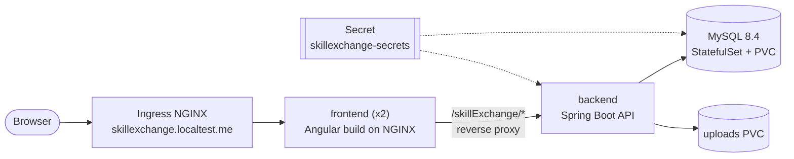

# SkillExchange: containerization & Kubernetes deployment

[](https://github.com/onsgharbii/skillexchange-devops/actions/workflows/ci.yml)

**SkillExchange** is a skill-sharing platform built by a team of 7 students at ESPRIT, with courses, events, a forum, a marketplace, quizzes and certificates. It has a **Spring Boot 3 / Java 17** API and an **Angular 16** frontend.

This repository packages it to run anywhere: **multi-stage Docker images, Docker Compose, Kubernetes manifests and a CI pipeline that tests the whole stack before publishing images**. The application code is not copied here. Both upstream repositories are included as **Git submodules**, pinned to a specific commit.

| Path | Content |
|---|---|
| `backend/` | submodule → [nour-allani/SkillExchange-Spring](https://github.com/nour-allani/SkillExchange-Spring) |
| `frontend/` | submodule → [welhazitakwa/skillExchange_Angular](https://github.com/welhazitakwa/skillExchange_Angular) |
| `docker/` | Dockerfiles, env-driven Spring configuration, NGINX template |
| `docker-compose.yml` | local stack: MySQL + API + frontend |
| `k8s/` | Kustomize manifests: MySQL StatefulSet, API, frontend, Ingress |
| `.github/` | CI pipeline and Dependabot (submodule and action updates) |

## Architecture



## What this repository solves

| Problem in the upstream code | Solution here |
|---|---|
| Credentials hard-coded in `application.properties` | At build time, the file is replaced by [a version](docker/backend/application.properties) where **every value comes from an environment variable**. No secret ends up in the images or in this repository. |
| Frontend calls `http://localhost:8084` directly, so it only works on a developer laptop | At build time, the URLs are rewritten to relative paths, and the frontend's NGINX proxies `/skillExchange/` to the API. The same image then works behind any host, with no CORS configuration. |
| Some integrations (PayPal) call their API at startup and crash without credentials | Spring **lazy initialization**: the app starts, and each integration is only created when it is used. |
| API crash-loops on Kubernetes when MySQL is not ready yet | An `initContainer` waits for MySQL before the API starts. |
| Angular style budgets fail the production build | Budgets are relaxed at build time. |

The upstream repositories stay untouched: all adaptations happen in the image build.

## Images

- **backend**: Maven build stage (dependencies cached in their own layer), then a JRE-only runtime. Non-root user, memory-aware JVM (`MaxRAMPercentage`).
- **frontend**: Node build stage, then unprivileged NGINX. The backend URL is injected at container start (`BACKEND_URL`).

## Run with Docker Compose

```bash
git clone --recurse-submodules https://github.com/onsgharbii/skillexchange-devops.git
cd skillexchange-devops
cp .env.example .env        # set DB_PASSWORD / DB_ROOT_PASSWORD
docker compose up --build   # http://localhost:8080  (FRONTEND_PORT to change it)
```

## Deploy on Kubernetes

Requirements: any cluster with an NGINX Ingress controller. A local `kind` cluster works.

```bash
kubectl create namespace skillexchange
kubectl -n skillexchange create secret generic skillexchange-secrets --from-env-file=.env
kubectl apply -k k8s/
# http://skillexchange.localtest.me
```

What the manifests provide:
- MySQL as a **StatefulSet** with a persistent volume and a readiness probe.
- The API with startup, readiness and liveness probes, resource requests and limits, and a persistent volume for uploads.
- The frontend with 2 replicas behind the Ingress.
- All credentials read from a single Secret that is created outside Git.

## CI pipeline

[ci.yml](.github/workflows/ci.yml) runs on every push and pull request:

1. **validate**: render the Kubernetes manifests and check the Compose file.
2. **smoke-test**: build the full stack with Compose, wait for the API, then **sign up and sign in a user through the frontend proxy**. Images are only published if a real user flow works.
3. **build**: build both images in parallel and push them to GHCR, tagged with the commit SHA and `latest`, with layer caching.

Dependabot opens a pull request when the upstream repositories change, so each new upstream version goes through the same smoke test.

## Team

SkillExchange was developed by [@MRGHOSJ](https://github.com/MRGHOSJ), [@nour-allani](https://github.com/nour-allani), [@onsgharbii](https://github.com/onsgharbii), [@azizkaraoui](https://github.com/azizkaraoui), [@welhazitakwa](https://github.com/welhazitakwa), [@Mohamed-Zaiter](https://github.com/Mohamed-Zaiter) and [@snoussimohamedmokhtar](https://github.com/snoussimohamedmokhtar) (ESPRIT, 2024–2025).

The containerization, Kubernetes deployment and CI in this repository are by **Ons Gharbi**. [LinkedIn](https://www.linkedin.com/in/ons-gharbi-8640852a7)
